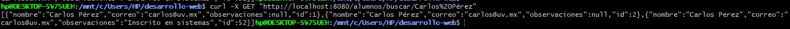

# Reporte de IA Desarrollo en el Proyecto

**Fecha: 16/11/2026**  
**Número de reporte: 1**  

---

# 1. Breve descripción de uso

Se le preguntó a la inteligencia artificial poder acompañar en la solución de un problema de aplicación de filtros para devolver una lista

---

# 2. Evidencias de uso

| Evidencia | Formato | 
|------------|------------------------|
Herramienta | Gemini
Modelo/temperatura | Gemini/0.2
Prompt original | Como puedo implemenatr filtrado por nombre para devolver una lista de alumnos?
Respuesta de IA | La sugerencia de usar List<Alumno> findByNombre(String nombre); en la interfaz y el método @GetMapping en el controlador: List<Alumno> findByNombre(String nombre); y  @GetMapping("/alumnos/buscar/{nombre}") public List<Alumno> buscarPorNombre(@PathVariable String nombre) { return iAlumno.findByNombre(nombre); }
Código anterior | 62f3a54
Código posterior |  cec5308
Diferencias entre versiones | 1       2       "documentaci\303\263n/r-ia-doc-1.md"
 => IAG/r-ia-doc-1.md    0       0       IAG/r-ia-doc.md
11      1       backend/src/main/java/com/equipo4/gestion_escuela/Alumno.java
26      0  backend/src/main/java/com/equipo4/gestion_escuela/AlumnoControlador.java
7       1       backend/src/main/java/com/equipo4/gestion_escuela/IAlumno.java
Prueba de funcionamiento | 
Código de uso | Generación 
Reflexión del estudiante | El uso de la IA facilitó comprender el como hacer filtrados, en este caso, por nombre. Esto hizo que aprendiera la sintaxis y asi poder hacer un segundo filtrado, el cual es por correo

---

## Observaciones adicionales
